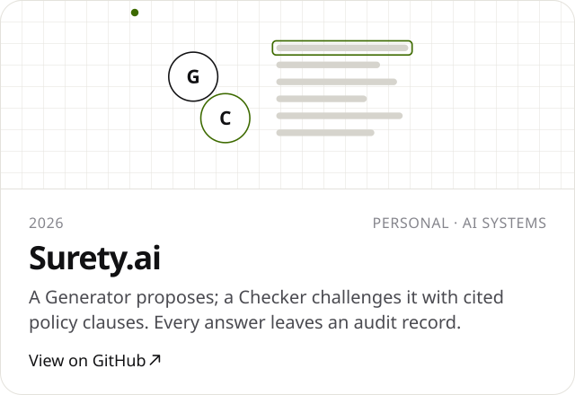
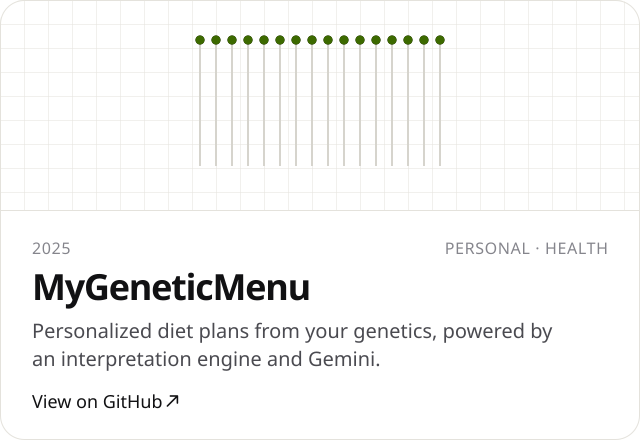
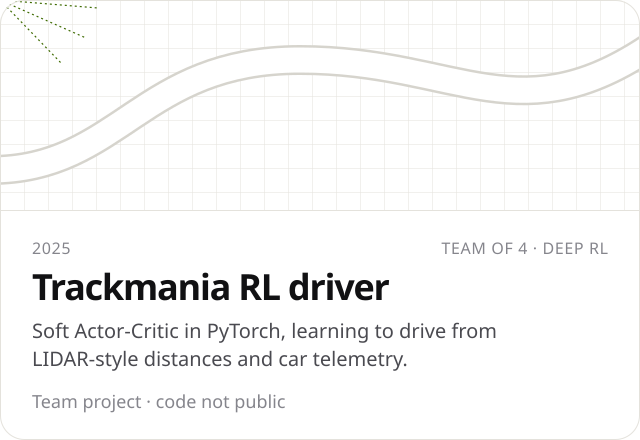
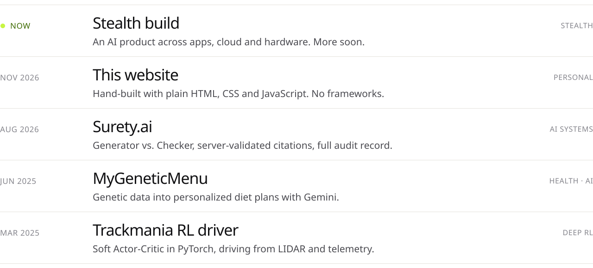
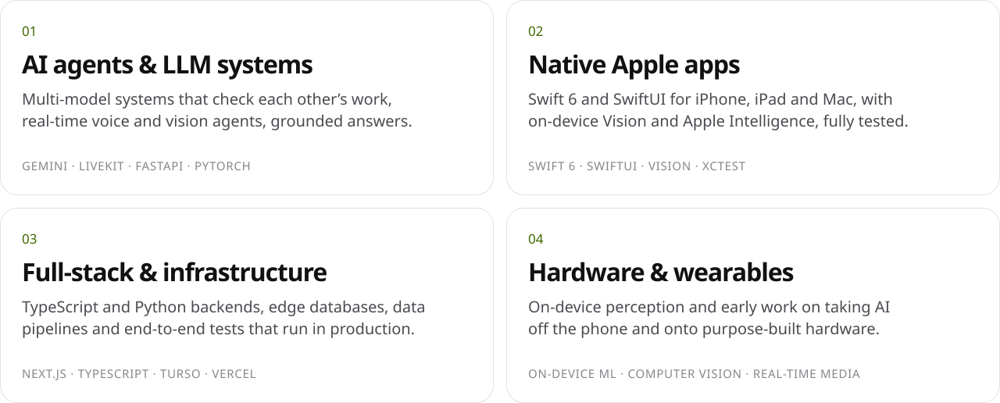

<!-- v2: matches shaileshmaddikera.github.io. The simpler v1 is on the `v1-classic` branch and in versions/README-v1-classic.md. Images are built by tools/build.py. -->

<a href="https://shaileshmaddikera.github.io"><picture><source media="(prefers-color-scheme: dark)" srcset="assets/header-dark.svg"></picture></a>

<a href="https://shaileshmaddikera.github.io"><picture><source media="(prefers-color-scheme: dark)" srcset="assets/pill-website-dark.svg"></picture></a>
<a href="https://www.linkedin.com/in/shailesh-maddikera/"><picture><source media="(prefers-color-scheme: dark)" srcset="assets/pill-linkedin-dark.svg"></picture></a>
<a href="https://shaileshmaddikera.wixsite.com/shailesh-maddikera-o/resume-1"><picture><source media="(prefers-color-scheme: dark)" srcset="assets/pill-resume-dark.svg"></picture></a>

 

<picture><source media="(prefers-color-scheme: dark)" srcset="assets/label-work-dark.svg"></picture>

<a href="https://github.com/ShaileshMaddikera/Surety.ai"><picture><source media="(prefers-color-scheme: dark)" srcset="assets/card-surety-dark.svg"></picture></a>
<picture><source media="(prefers-color-scheme: dark)" srcset="assets/card-stealth-dark.svg"></picture>

<a href="https://github.com/ShaileshMaddikera/MyGeneticMenu"><picture><source media="(prefers-color-scheme: dark)" srcset="assets/card-dna-dark.svg"></picture></a>
<picture><source media="(prefers-color-scheme: dark)" srcset="assets/card-rl-dark.svg"></picture>

 

<picture><source media="(prefers-color-scheme: dark)" srcset="assets/label-journey-dark.svg"></picture>

<picture><source media="(prefers-color-scheme: dark)" srcset="assets/journey-dark.svg"></picture>

 

<picture><source media="(prefers-color-scheme: dark)" srcset="assets/label-focus-dark.svg"></picture>

<picture><source media="(prefers-color-scheme: dark)" srcset="assets/focus-dark.svg"></picture>

 

<a href="https://shaileshmaddikera.github.io"><picture><source media="(prefers-color-scheme: dark)" srcset="assets/footer-dark.svg"></picture></a>
